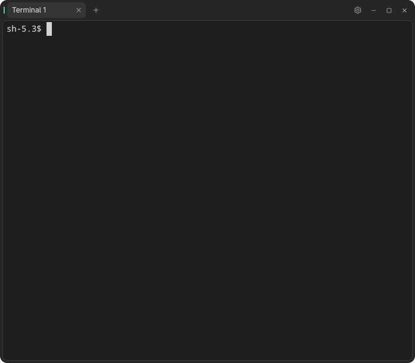

# f-tty

A compact GPU terminal written in Rust with [GPUI](https://gpui.rs).



## Features

- Multiple tabs, each with its own PTY and VTE emulator.
- Tab labels follow the shell title (OSC 0/2) or the current directory (OSC 7), falling back to `Terminal N`.
- Tab list position: **top, bottom, left or right**.
- Settings inside the terminal area, without taking up a tab.
- Searchable installed-font combobox in settings; tab position, shell and font are restored on the next launch.
- Mouse text selection and copy with `Ctrl+Shift+C`.
- 2,000-line scrollback per tab: mouse wheel and `Shift+PageUp` / `Shift+PageDown`.
- Grid and PTY resized to the actual window space (SIGWINCH); existing text rewraps to the new width without changing the font size.
- Automatic shell detection (`/etc/shells` on Unix, `COMSPEC`/PATH on Windows).
- Custom title bar: round controls on Linux, full-height captions on Windows, native traffic lights on macOS.
- Flat dark theme, rounded corners, English UI.

## Requirements

- Rust 1.100.0 or newer (edition 2024). GPUI needs stable `DropGuard`; `rust-toolchain.toml` pins 1.100.0 and `rustup` installs it automatically.
- **Linux**: Vulkan driver and development libraries for fontconfig, freetype, xkbcommon and Wayland/X11.
  - Debian/Ubuntu: `sudo apt install gcc g++ clang cmake pkg-config libfontconfig-dev libfreetype-dev libwayland-dev wayland-protocols libxkbcommon-dev libxkbcommon-x11-dev libx11-xcb-dev libxcb1-dev libxcb-render0-dev libxcb-shape0-dev libxcb-xfixes0-dev libssl-dev libvulkan-dev libvulkan1`
  - Fedora: `sudo dnf install gcc-c++ clang cmake pkg-config fontconfig-devel freetype-devel wayland-devel libxkbcommon-devel libxkbcommon-x11-devel libX11-devel libxcb-devel vulkan-devel`
- **Windows**: Rust MSVC toolchain with Visual Studio Build Tools (or GNU toolchain with MinGW); a C compiler is required for dependencies.
- **macOS**: Xcode and Command Line Tools.

## Build

```sh
cargo build --release
./target/release/ftty
```

## Shortcuts

| Action | Key |
| --- | --- |
| New tab | `Ctrl+Shift+T` |
| Close pane (last pane: close tab) | `Ctrl+Shift+W` |
| Split right / down | `Ctrl+Shift+D` / `Ctrl+Shift+E`: any pane, any direction, nested like tmux (up to 8 per tab, each new pane opens in the same directory) |
| Focus the pane left / right / above / below | `Ctrl+Shift+Arrow` (wraps around), or click |
| Previous / next pane in order | `Ctrl+Shift+[` / `Ctrl+Shift+]` |
| Zoom pane | `Ctrl+Shift+Z` or `Ctrl+Shift+Enter` |
| Resize panes | drag a divider, or `Ctrl+Alt+Shift+Arrow` (moves the nearest border that way) |
| Equalize panes | double-click a divider (that split), or `Ctrl+Alt+Shift+=` (all) |
| Swap pane with previous / next | `Ctrl+Alt+Shift+[` / `]` |
| Broadcast typing to all panes | `Ctrl+Shift+B` |
| Next / previous tab | `Ctrl+Tab` / `Ctrl+Shift+Tab` |
| Copy selection | `Ctrl+Shift+C` |
| Find in scrollback | `Ctrl+Shift+F`, `Enter` / `Shift+Enter`, `Esc` |
| Previous / next prompt | `Ctrl+Shift+PageUp` / `Ctrl+Shift+PageDown` |
| Open a link | `Ctrl+click` (OSC 8 links and plain `http(s)://` URLs) |
| Scroll history | mouse wheel, `Shift+PageUp` / `Shift+PageDown` |
| Back to the present | type a key or scroll to the bottom |
| Open/close settings | gear button |

## Shell integration (optional)

Prompt jumping and "command finished" markers use OSC 133, which shells do not
send on their own. Add the matching snippet to your shell config:

```sh
# bash (~/.bashrc)
PS1='\[\e]133;A\a\]'"$PS1"
PROMPT_COMMAND='printf "\e]133;D\a"'"${PROMPT_COMMAND:+;$PROMPT_COMMAND}"

# zsh (~/.zshrc)
_ftty_d() { print -Pn '\e]133;D\a' }
autoload -Uz add-zsh-hook && add-zsh-hook precmd _ftty_d
PS1=$'%{\e]133;A\a%}'$PS1
```

```powershell
# PowerShell ($PROFILE)
function prompt { "$([char]27)]133;D$([char]7)$([char]27)]133;A$([char]7)PS $PWD> " }
```

A tab in the background shows its attention dot when a command finishes.

The same hooks report the current directory (OSC 7), which is how a new tab
or split opens where the previous one was. bash and zsh get all of this
automatically; other shells need an equivalent `OSC 7` line in their prompt.
A pane closes when its shell exits.

## Configuration

Preferences are saved in `%APPDATA%\ftty\settings.txt` on Windows and in
`$XDG_CONFIG_HOME/ftty/settings.txt` (or `~/.config/ftty/settings.txt`) on Unix.
Delete that file to return to the defaults.

## Status

Tested on Linux (KDE Wayland). The Windows code has been checked with
`cargo check --target x86_64-pc-windows-gnu`, but the app has not been run on
Windows hardware yet; macOS has not been verified.

## License

The icons in `assets/icons/` are Heroicons, MIT licensed (see
`assets/icons/LICENSE`). The project license has not been chosen yet.
